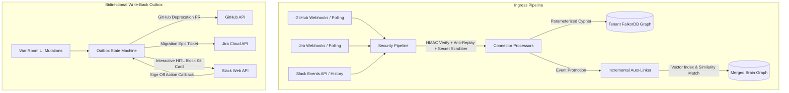
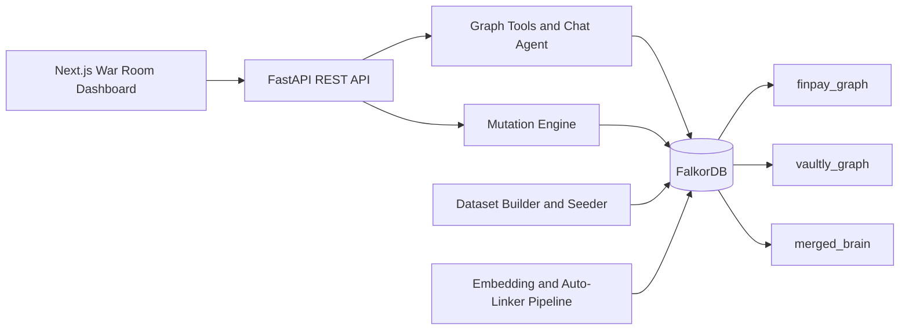

# OrgBridge AI — The M&A Chaos Resolver

**A FalkorDB-powered knowledge graph for post-merger integration.** OrgBridge AI helps teams explore cross-company dependencies, identify potentially redundant systems, inspect policy and architectural conflicts, trace decisions to source documents, and update the shared graph as integration decisions are made.

> Hackathon project: FalkorDB / WeMakeDevs — Company Brain, Track 03: Keeping Knowledge Current.

## Contents

- [Problem and solution](#problem-and-solution)
- [Hosted deployment references](#hosted-deployment-references)
- [Features](#features)
- [Enterprise Live Connectors (GitHub, Jira, Slack)](#enterprise-live-connectors-github-jira-slack)
- [Architecture](#architecture)
- [Technology stack](#technology-stack)
- [Repository layout](#repository-layout)
- [Graph model](#graph-model)
- [Cypher queries and graph algorithms](#cypher-queries-and-graph-algorithms)
- [Getting started with Docker](#getting-started-with-docker)
- [Local development without Docker](#local-development-without-docker)
- [Environment variables](#environment-variables)
- [Using the application](#using-the-application)
- [CLI reference](#cli-reference)
- [HTTP API reference](#http-api-reference)
- [Authentication and security notes](#authentication-and-security-notes)
- [Testing](#testing)
- [Deployment](#deployment)
- [Troubleshooting](#troubleshooting)
- [Known implementation notes](#known-implementation-notes)
- [Demo walkthrough](#demo-walkthrough)
- [License](#license)

## Problem and solution

During an acquisition, two companies may have services that perform similar jobs, policies that impose different requirements, and teams that lack clear paths to the right subject-matter experts. Those issues are difficult to resolve when relevant evidence is spread across disconnected documents and systems.

OrgBridge AI models the acquisition of **Vaultly** by **FinPay** as a graph. It keeps each company's entities in a separate FalkorDB graph while providing a merged graph for cross-company analysis. A FastAPI service exposes graph tools and a chat agent; a Next.js dashboard lets users explore results and inspect graph entities.

The included FinPay and Vaultly data is **synthetic demonstration data**. It is intended to show graph workflows, not to represent real companies or compliance advice.

## Hosted deployment references

The repository currently contains these deployment references:

- **Dashboard:** <https://falkordb-powered-resolver.vercel.app>
- **Backend API:** <https://orgbridge-ai-backend.onrender.com>
- **Swagger UI:** <https://orgbridge-ai-backend.onrender.com/docs>
- **Health endpoint:** <https://orgbridge-ai-backend.onrender.com/api/health>

These URLs are configuration/documentation references, not an uptime guarantee. Verify the active Vercel deployment before sharing the dashboard link; `DEMO_GUIDE.md` also references the active project workflow.

## Features

### Multi-graph company model

The application uses three configurable graph names:

- `finpay_graph` — FinPay entities and relationships.
- `vaultly_graph` — Vaultly entities and relationships.
- `merged_brain` — both companies, shared external dependencies, and cross-company bridge relationships.

Graph names are configured through environment variables. The main graph-tool, chat, visualization, and mutation routes validate supported graph names; check route-specific behavior when integrating through the generic MCP dispatcher.

### Graph-assisted M&A analysis

Six deterministic graph tools are exposed through the backend:

1. **Subject-matter expert discovery** — ranks people using stored graph-influence/PageRank data and topic-related evidence from authored documents, resolved tickets, and owned systems. The tool returns an explicit insufficient-evidence result when topic evidence is missing.
2. **Policy conflict reporting** — reports active `CONFLICTS_WITH` policy relationships and links back to available source documents.
3. **Redundant system discovery** — reports systems linked by `REDUNDANT_WITH`, including their owners and shared external APIs where available.
4. **Decision lineage** — traverses system governance relationships to show governing decisions, conflicting decisions, and related sources.
5. **Warm-introduction path** — finds a bounded shortest graph path between two people using deterministic entity resolution and ambiguity guards.
6. **Organizational silo analysis** — attempts FalkorDB's WCC procedure and falls back to a Python adjacency traversal when the procedure is unavailable. External-only components are classified separately from organizational silos.

### Hybrid vector and graph matching

The auto-linker combines vector similarity with graph-derived signals, including shared `ExternalAPI` dependencies and domain alignment. It can create or update `REDUNDANT_WITH` and `CONFLICTS_WITH` bridge edges in the target graph.

- 384-dimensional vectors are generated for `System`, `Policy`, `Decision`, and `Team` nodes.
- FalkorDB vector indexes are configured for those labels.
- If `OPENAI_API_KEY` is provided, the embedding service uses `text-embedding-3-small` with the configured 384-dimensional output.
- Without a working OpenAI embedding client, it uses a deterministic local hash-and-anchor baseline. This offline baseline is a heuristic, not an equivalent substitute for a trained embedding model.

### Conversational graph assistant with 3-layer domain guardrails

The chat endpoint uses Groq when configured, then an OpenAI chat fallback when available. If no LLM client is configured, it uses a deterministic intent router.

To ensure the assistant strictly stays within the M&A and graph domain, it enforces a **Three-Layer Guardrail Architecture**:
- **Layer 1 (Pre-flight keyword gate):** Zero-cost classification blocks off-topic queries (general coding help like Java/Python, recipes, weather, general trivia) immediately with a canonical domain guidance response without incurring LLM token costs or risk of hallucinations.
- **Layer 2 (Hardened System Prompt):** Explicit mandatory domain boundary instructions strictly telling the LLM to refuse off-topic questions.
- **Layer 3 (Post-flight Intercept):** Catches ungrounded direct text responses to prevent jailbreaks.
- **Read-Only Cypher Security Boundary:** Strictly parses query structure, limits variable-length traversal (`[*1..4]`), enforces result limits (`LIMIT 25`), and applies execution timeouts for ad-hoc read-only Cypher.

### Live graph mutations (Track 03: Keeping Knowledge Current)

The UI and CLI can:

- resolve the example authentication-session policy conflict;
- resolve the example log-retention conflict;
- merge two teams while preserving historical membership and ownership data; and
- reset/reseed the demo graphs.

Mutation operations validate key input ranges and preconditions (with explicit compliance overrides required for high-risk configurations) and perform post-mutation verification. **Reset is destructive:** it clears and reseeds the three demo graphs, so use it only against a development or demo database.

### Interactive dashboard

The Next.js dashboard includes:

- a tenant selector for the three graph views;
- live connector status health badges in the header for GitHub, Jira, and Slack;
- an assistant chat panel with one-click evaluation prompts;
- a force-directed 2D graph canvas with zoom, fit, maximize, and subgraph controls;
- a node inspector for entity attributes;
- last-known-good graph retention and an offline synthetic graph preview; and
- a bounded session transcript with export and clear controls.

## Enterprise Live Connectors (GitHub, Jira, Slack)

To address **Track 03: Keeping Knowledge Current**, OrgBridge AI includes bidirectional live connectors with enterprise-grade security pipelines and real-time FalkorDB synchronization.



### Connector Capabilities

| Provider | Ingress (Sync & Webhooks) | Egress (Bidirectional Write-Back) | Security & Isolation |
|---|---|---|---|
| **GitHub** | Ingests manifests (`package.json`, `pom.xml`), `CODEOWNERS` (mapped to `Person`/`Team`), ADRs (`docs/adr/*.md` -> `Decision`), handles privatized repo tombstones. | Dispatches deprecation Pull Requests with migration links upon policy resolution. | Constant-time HMAC-SHA256 (`X-Hub-Signature-256`), 5-min replay protection, strict 1MB payload ceiling. |
| **Jira** | Ingests incident/sprint tickets, maps assignees with PageRank influence boosts, ADR issues, handles issue tombstones. | Automatically files cross-company Migration Epic tickets linking conflicting systems. | OAuth 2.0 (3LO) with Fernet AES-256-GCM token encryption, RSA signature verification, 15m delta polling. |
| **Slack** | Captures thread collaboration topology (`[:COLLABORATES_WITH]`), reaction-driven decision capture (`:memo:`, `:white_check_mark:`), dynamic text resolution via `conversations.history`. | Posts interactive Block Kit resolution cards with human-in-the-loop (HITL) sign-off buttons. | HMAC-SHA256 (`v0:` scheme), bot loop guards (`is_bot_event`), channel archive tombstones. |

### Enterprise Security Core

All connectors run through a zero-trust `src/connectors/security_pipeline.py`:
- **HMAC Constant-Time Verification**: Prevents timing attacks across GitHub, Jira, and Slack payloads.
- **Replay Attack Defense**: 5-minute maximum drift window between timestamp and server epoch.
- **24-Hour Idempotency Cache**: Guarantees exactly-once ingestion semantics across retried webhook deliveries.
- **Shannon Entropy Secret Scrubber**: Scans untrusted payload text with regex patterns (AWS, GitHub, Slack tokens, private keys) and Shannon entropy thresholds ($H \ge 4.5$) to scrub credentials before LLM or graph exposure.
- **Bot Loop Guard**: Ignores events triggered by the bot's own user ID or subtype `bot_message`.
- **Cypher Injection Immunity**: Every write is strictly parameterized (`$params`) through `cypher_schema.py`.
- **Deterministic Person Identity**: Hashing with `generate_person_id(email)` ensures unified person identity resolution across disparate provider user accounts.
- **Outbox State Machine**: Reliable write-backs with `PENDING`, `SYNCED`, and `FAILED` states with retry exponential backoff (`/api/mutate/outbox-retry`).

## Architecture



### Request and data flow

1. The synthetic dataset is converted into Cypher statements by `src/data/builder.py`.
2. `src/data/seed.py` seeds the isolated company graphs and the merged graph.
3. `src/pipeline/auto_linker.py` populates embeddings, ensures vector indexes, and discovers cross-company links.
4. The FastAPI service exposes tool results, subgraphs, chat, and mutation operations.
5. The Next.js frontend renders graph data and sends user requests to the API.

## Technology stack

| Layer | Technologies |
|---|---|
| Graph database | FalkorDB, Cypher, vector indexes, graph traversals |
| Backend | Python 3.11+, FastAPI, Pydantic, Uvicorn |
| Agent providers | Groq and optional OpenAI; deterministic fallback when no provider is available |
| Embeddings | OpenAI `text-embedding-3-small` when configured; local deterministic heuristic fallback |
| Frontend | Next.js 14, React 18, TypeScript, Tailwind CSS |
| Visualization | `react-force-graph-2d` |
| Live Connectors | GitHub App / Webhooks, Atlassian Jira Cloud 3LO, Slack Events / Block Kit |
| Security | Fernet AES-256-GCM TokenVault, HMAC-SHA256, Shannon Entropy Secret Scrubber |
| Tests | Pytest (89 passing tests across core and connectors) |
| Local orchestration | Docker Compose |

## Repository layout

```text
chaos-resolver-folkordb/
├── Dockerfile
├── docker-compose.yml
├── render.yaml
├── run.py
├── requirements.txt
├── .env.example
├── DEMO_GUIDE.md
├── artifacts/                     # Generated Cypher files, when exported
├── src/
│   ├── api/
│   │   ├── auth.py                # API-key / role dependencies
│   │   └── main.py                # FastAPI routes, webhooks & CORS
│   ├── connectors/                # Enterprise Live Ingress & Egress
│   │   ├── base.py                # BaseConnector abstract specification
│   │   ├── security_pipeline.py   # HMAC, replay window, secret scrubber, TokenVault
│   │   ├── github.py              # GitHub manifests, CODEOWNERS, ADRs, tombstones
│   │   ├── jira.py                # Jira sprint/incident tickets, PageRank assignees
│   │   └── slack.py               # Collaboration topology, reaction decisions
│   ├── data/
│   │   ├── synthetic_data.py      # Synthetic FinPay and Vaultly dataset
│   │   ├── builder.py             # Dataset validation and Cypher generation
│   │   └── seed.py                # Seeding and export commands
│   ├── db/client.py               # FalkorDB thread-safe client with retries
│   ├── embeddings/service.py      # Embedding provider and offline fallback
│   ├── pipeline/
│   │   ├── auto_linker.py         # Hybrid vector + graph matching
│   │   ├── vector_index.py        # Vector index and embedding population
│   │   ├── policy_validator.py    # Policy validation logic
│   │   └── mutations.py           # Live graph mutations and reset
│   ├── schema/
│   │   ├── models.py              # Pydantic graph models
│   │   └── cypher_schema.py       # Graph schema, query validation, Cypher builders
│   ├── tools/
│   │   ├── graph_tools.py         # Six deterministic graph tools and subgraphs
│   │   ├── llm_agent.py           # Chat agent, 3-layer guardrail, and constrained Cypher
│   │   └── mcp_server.py          # MCP-style tool definitions and dispatcher
│   ├── cli.py                     # CLI and interactive REPL
│   └── utils/logger.py            # Logging configuration
├── frontend/
│   ├── app/                       # Next.js app entry points
│   ├── components/                # Chat, graph canvas, node inspector
│   └── lib/                       # API client, config, fallback graph, helpers
└── tests/
    ├── test_schema_and_dataset.py # Schema, query sanitization, endpoint uniqueness (14 tests)
    ├── test_auto_linker.py        # Embeddings, auto-linker, candidate pairs (9 tests)
    ├── test_agent_tools.py        # Tools, WCC, warm intro, visualization, chat (21 tests)
    ├── test_live_mutations.py     # Mutations, compliance bounds, resets (11 tests)
    ├── test_connector_phase1.py   # Security pipeline, HMAC, TokenVault, Cypher injection (17 tests)
    ├── test_connector_phase2.py   # GitHub/Jira/Slack ingestion & incremental auto-linking (9 tests)
    └── test_connector_phase3.py   # Outbox state machine & write-backs (8 tests)
```

## Graph model

### Node labels

| Label | Representative properties | Purpose |
|---|---|---|
| `Person` | `id`, `name`, `role`, `department`, `email`, `pagerank`, `company_origin` | Engineers and subject-matter experts |
| `Team` | `id`, `name`, `charter`, `company_origin` | Organizational units |
| `System` | `id`, `name`, `tech`, `domain`, `description`, `tier`, `repo`, `company_origin` | Microservices and systems |
| `Document` | `id`, `title`, `doc_type`, `url`, `excerpt`, `author_id`, `company_origin` | RFCs, audit documents, and other evidence |
| `Ticket` | `id`, `title`, `ticket_type`, `severity`, `status`, `external_id`, `company_origin` | Incidents and engineering tasks |
| `Decision` | `id`, `summary`, `date`, `effective_date`, `authority_level`, `status`, `source`, `company_origin` | Architecture and governance decisions |
| `Policy` | `id`, `name`, `domain`, `description`, `effective_date`, `authority_level`, `status`, `source`, `company_origin` | Security and compliance policies |
| `ExternalAPI` | `id`, `name`, `category`, `provider`, `company_origin` | Shared third-party dependencies |

Company-owned entities use namespaced IDs such as `finpay:sys:gatekeeper_auth` and `vaultly:sys:pulse_identity` so identical display names can remain separate entities.

### Relationship types

The schema supports the following relationship types. Their direction matters for traversal and lineage.

| Relationship | Typical use |
|---|---|
| `MEMBER_OF` | Person → Team |
| `OWNS` | Person/Team → System |
| `AUTHORED` | Person → Document |
| `RESOLVED` | Person → Ticket |
| `AFFECTS` | Ticket → System |
| `GOVERNED_BY` | System → Decision/Policy |
| `DEPENDS_ON` | System → System |
| `CALLS` | System → ExternalAPI |
| `DERIVED_FROM` | Decision/Policy → Document/Ticket |
| `REDUNDANT_WITH` | Candidate duplicate systems, with score and reason metadata |
| `CONFLICTS_WITH` | Candidate policy or decision conflicts, with status/severity/reason metadata |
| `SUPERSEDES` | Unified decisions/teams and historical entities |

The merged graph adds cross-company relationships. The analysis tools use these edges as evidence; they do not replace human review for actual architecture, security, or regulatory decisions.

## Cypher queries and graph algorithms

OrgBridge AI is built directly on FalkorDB's native Cypher engine and graph procedures. Below are the key Cypher queries and graph algorithms the product depends on:

### 1. Vector Indexing & Semantic Search (`db.idx.vector`)
Dense 384-dimensional embeddings are indexed and queried natively on FalkorDB:
```cypher
-- Vector Index Creation (System, Policy, Decision, Team)
CREATE VECTOR INDEX FOR (s:System) ON (s.embedding) OPTIONS {dimension: 384, similarityFunction: 'cosine'};
CREATE VECTOR INDEX FOR (p:Policy) ON (p.embedding) OPTIONS {dimension: 384, similarityFunction: 'cosine'};

-- Vector Similarity Query (Nearest Neighbor Search)
CALL db.idx.vector.queryNodes('System', 'embedding', $k, vecf32($vec))
YIELD node, score
RETURN node, score;
```

### 2. Graph Algorithms: Weakly Connected Components (`algo.wcc`)
Discovers isolated organizational islands and multi-company integration clusters:
```cypher
-- FalkorDB Native WCC Graph Algorithm Procedure
CALL algo.wcc()
YIELD node, componentId
RETURN node, componentId;
```
*(Includes a seamless Python BFS queue traversal fallback if native `algo.wcc` procedure is unavailable).*

### 3. SME Expert Discovery via Influence Ranking & Multi-Hop Lineage
Ranks personnel using stored GraphBLAS PageRank centrality combined with domain-specific artifact authorship, incident resolutions, and system ownership:
```cypher
MATCH (p:Person {company_origin: $company})
OPTIONAL MATCH (p)-[:AUTHORED]->(doc:Document)
OPTIONAL MATCH (p)-[:RESOLVED]->(tkt:Ticket)
OPTIONAL MATCH (p)-[:OWNS]->(s:System)
RETURN p.id, p.name, p.role, p.department, p.pagerank,
       collect(DISTINCT doc.title) as authored_docs,
       collect(DISTINCT tkt.title) as resolved_tickets,
       collect(DISTINCT s.name) as owned_systems;
```

### 4. Warm Introduction Bounded Path Traversal (`shortestPath` / `[*1..4]`)
Bridges engineers across merging entities by finding the shortest topological path through organizational ties, shared systems, or joint documentation:
```cypher
-- Native shortestPath with Hop Bounding
MATCH (a:Person {id: $p_a_id}), (b:Person {id: $p_b_id})
WITH shortestPath((a)-[*..5]-(b)) as p
WHERE p IS NOT NULL
RETURN [n in nodes(p) | n.id] as node_ids,
       [n in nodes(p) | coalesce(n.name, n.id)] as node_names,
       [r in relationships(p) | [startNode(r).id, endNode(r).id, type(r)]] as rel_triplets,
       length(p) as hops;

-- Bidirectional Bounded Path Fallback
MATCH (a:Person {id: $p_a_id}), (b:Person {id: $p_b_id})
MATCH p = (a)-[*1..4]-(b)
RETURN p, length(p) as hops
ORDER BY hops ASC
LIMIT 1;
```

### 5. Decision & Policy Governance Lineage Tracing
Traverses causal links from microservices to governing decisions, opposing decisions, and source RFC documents:
```cypher
MATCH (s:System {id: $sys_id})
OPTIONAL MATCH (s)-[:GOVERNED_BY]->(d:Decision)
OPTIONAL MATCH (d)-[r_conf:CONFLICTS_WITH]-(dc:Decision)
OPTIONAL MATCH (d)-[:DERIVED_FROM]->(doc:Document)
OPTIONAL MATCH (d)-[:DERIVED_FROM]->(tkt:Ticket)
OPTIONAL MATCH (dc)-[:DERIVED_FROM]->(cdoc:Document)
RETURN s.name, d.summary, d.status, type(r_conf), dc.summary, dc.status,
       doc.title, doc.url, tkt.title, cdoc.title;
```

### 6. Redundant Microservices & Shared External Dependency Analysis
Detects duplicate services across corporate boundaries and checks for shared third-party dependencies (e.g. UIDAI Aadhaar, AWS KMS, Stripe):
```cypher
MATCH (s1:System)-[r:REDUNDANT_WITH]-(s2:System)
WHERE s1.company_origin <> s2.company_origin
OPTIONAL MATCH (p1:Person)-[:OWNS]->(s1)
OPTIONAL MATCH (p2:Person)-[:OWNS]->(s2)
OPTIONAL MATCH (s1)-[:CALLS]->(ext:ExternalAPI)<-[:CALLS]-(s2)
RETURN s1.name, s1.domain, s2.name, s2.domain, r.similarity, r.reason,
       collect(DISTINCT ext.name) as shared_external_apis;
```

### 7. Real-Time Knowledge Mutations (Track 03 Cypher `MERGE` / `SET`)
Dynamically updates knowledge state as architects resolve policy contradictions or merge teams:
```cypher
-- Deprecate Conflicting Policies in Real-Time
MATCH (p1:Policy {id: 'finpay:pol:session_security'})-[r:CONFLICTS_WITH]->(p2:Policy {id: 'vaultly:pol:session_continuity'})
SET p1.status = 'DEPRECATED',
    p2.status = 'DEPRECATED',
    r.status = 'RESOLVED',
    r.resolved_at = $timestamp,
    r.resolution_note = 'Superceded by Unified M&A Hybrid Session Standard';

-- Create Unified Standard Node & Relink Governance Edges
MERGE (pol:Policy {id: 'unified:pol:hybrid_session_auth'})
ON CREATE SET
    pol.name = 'Unified M&A Adaptive Session Policy',
    pol.domain = 'Authentication',
    pol.company_origin = 'Unified',
    pol.status = 'ACTIVE',
    pol.effective_date = $effective_date,
    pol.description = $pol_desc;

-- Relink Microservices from Deprecated Policies to the New Standard
MATCH (s:System)-[g:GOVERNED_BY]->(p:Policy)
WHERE p.id IN ['finpay:pol:session_security', 'vaultly:pol:session_continuity']
DELETE g
WITH s
MATCH (new_pol:Policy {id: 'unified:pol:hybrid_session_auth'})
MERGE (s)-[:GOVERNED_BY]->(new_pol);
```

### 8. Subgraph Visualization Prioritization Query
Pulls visual neighborhoods into `react-force-graph-2d`, ensuring critical cross-company bridge relationships and their endpoints are always prioritized:
```cypher
MATCH (a)-[r:CONFLICTS_WITH|REDUNDANT_WITH|SUPERSEDES]->(b)
RETURN a, r, b
LIMIT $rel_limit;
```

Docker Compose starts FalkorDB, the FastAPI backend, and the Next.js frontend. Seeding is a separate step.

### Prerequisites

- Docker Engine or Docker Desktop with the Compose plugin.
- Git.
- A Groq or OpenAI API key only if you want remote LLM/embedding providers. The app has deterministic fallbacks for local demonstration.

### 1. Clone and configure

```bash
git clone https://github.com/yashhh-23/chaos-resolver-folkordb.git
cd chaos-resolver-folkordb
cp .env.example .env
```

For the default Compose configuration, FalkorDB is secured with loopback binding (`127.0.0.1:6379:6379`) and a password:

```dotenv
FALKORDB_PASSWORD=changeme_in_production
```

That value is a **local development example only**. Replace it with a unique value for any non-local environment. Add `GROQ_API_KEY` and/or `OPENAI_API_KEY` if needed.

### 2. Start the stack

```bash
docker compose up --build -d
```

**Frontend build-time configuration:** Next.js inlines `NEXT_PUBLIC_*` values when the frontend is built. The current Compose file sets `NEXT_PUBLIC_API_URL` as a container runtime variable, while the frontend Dockerfile runs `next build` during image build. If the built dashboard calls the hosted API instead of `http://localhost:8000`, pass the local API URL into the frontend image build (for example, via Docker build arguments/build-time environment) and rebuild it. The non-Docker development setup below reads `frontend/.env.local` before `npm run dev`.

Services:

| Service | Local URL / port | Purpose |
|---|---|---|
| Frontend | <http://localhost:3000> | War Room dashboard |
| Backend | <http://localhost:8000> | FastAPI service |
| Swagger | <http://localhost:8000/docs> | Interactive API reference |
| FalkorDB | `127.0.0.1:6379` | Graph database, bound to loopback by Compose |

### 3. Seed the graphs

The containers do not automatically seed data at startup. Run the seeder once after the database is healthy:

```bash
docker compose exec backend python -m src.data.seed --clear --verify
```

`--clear` deletes the graph's existing nodes before loading the synthetic baseline. Do not run it against a graph that contains data you need to preserve.

### 4. Run the auto-linker

```bash
docker compose exec backend python -m src.pipeline.auto_linker --graph merged_brain --threshold 0.82
```

This creates/populates the vector indexes and embeddings and runs the cross-company matching pipeline.

### 5. Check health

```bash
curl http://localhost:8000/api/health
```

Then open <http://localhost:3000>.

### Stop the stack

```bash
docker compose down
```

To remove the persistent local database volume as well, use `docker compose down -v`. **This deletes the local FalkorDB data volume.**

## Local development without Docker

You can run the backend and frontend as separate processes while using a local FalkorDB container or a FalkorDB Cloud instance.

### 1. Start FalkorDB

For the repository's local Compose service only:

```bash
docker compose up -d falkordb
```

If you use a different FalkorDB instance, configure the relevant host/port/credentials or `FALKORDB_URL` in the root `.env`.

### 2. Install Python dependencies

Python 3.11 or newer is recommended.

```bash
python -m venv .venv
```

Activate the environment:

```bash
# macOS / Linux
source .venv/bin/activate

# Windows PowerShell
.venv\Scripts\Activate.ps1
```

Install packages and create your local configuration:

```bash
pip install -r requirements.txt
cp .env.example .env
```

Set `FALKORDB_PASSWORD` to the password for your database.

### 3. Export Cypher scripts (optional)

This writes generated Cypher scripts under `artifacts/cypher/` without connecting to the database:

```bash
python -m src.data.seed --export-only
```

### 4. Seed and verify

```bash
python -m src.data.seed --clear --verify
```

### 5. Run the auto-linker

```bash
python -m src.pipeline.auto_linker --graph merged_brain --threshold 0.82
```

Alternatively, the CLI provides `auto-link`:

```bash
python -m src.cli auto-link --graph merged_brain --threshold 0.82
```

### 6. Start the backend

```bash
python -m src.cli serve --host 0.0.0.0 --port 8000
```

The API is available at <http://localhost:8000>; Swagger UI is at <http://localhost:8000/docs>.

### 7. Start the frontend

In a second terminal:

```bash
cd frontend
npm ci
```

Create `frontend/.env.local`:

```dotenv
NEXT_PUBLIC_API_URL=http://localhost:8000
NEXT_PUBLIC_ORGBRIDGE_API_KEY=orgbridge-war-room-2026
NEXT_PUBLIC_ORGBRIDGE_ADMIN_KEY=orgbridge-admin-war-room-2026
```

These values match the backend's default development keys. See [Authentication and security notes](#authentication-and-security-notes) before using these variables outside development.

Run Next.js:

```bash
npm run dev
```

Open <http://localhost:3000>.

## Environment variables

The backend reads settings through Pydantic Settings from environment variables and the root `.env` file. Variable names are case-insensitive in the settings layer; uppercase names are used below for clarity.

| Variable | Default / example | Description |
|---|---|---|
| `FALKORDB_HOST` | `localhost` | FalkorDB hostname |
| `FALKORDB_PORT` | `6379` | FalkorDB port |
| `FALKORDB_USERNAME` | unset | Optional database username |
| `FALKORDB_PASSWORD` | unset in Settings | Database password |
| `FALKORDB_SSL` | `false` | Enable TLS for host/port connections when supported by the selected instance |
| `FALKORDB_URL` | unset | Full FalkorDB connection URL; takes precedence over host/port connection setup |
| `GRAPH_FINPAY` | `finpay_graph` | FinPay graph name |
| `GRAPH_VAULTLY` | `vaultly_graph` | Vaultly graph name |
| `GRAPH_MERGED` | `merged_brain` | Merged graph name |
| `GROQ_API_KEY` | unset | Enables the Groq chat provider when configured |
| `OPENAI_API_KEY` | unset | Enables the OpenAI chat fallback and OpenAI embedding provider |
| `LLM_MODEL` | `llama-3.3-70b-versatile` | Preferred chat model identifier; provider availability may affect selection |
| `AUTO_LINKER_THRESHOLD` | `0.82` | Similarity threshold used by the auto-linker |
| `AUTO_LINKER_GRAPH_BONUS_PER_API` | `0.12` | Score bonus per shared external API |
| `AUTO_LINKER_DOMAIN_BONUS` | `0.05` | Domain alignment bonus |
| `AUTO_LINKER_MAX_SCORE` | `0.99` | Maximum combined score |
| `WARM_INTRO_MAX_DIRECTED_HOPS` | `5` | Maximum native shortest-path hops |
| `WARM_INTRO_MAX_BIDIRECTIONAL_HOPS` | `4` | Maximum fallback path hops |
| `SILOS_SUBGRAPH_MAX_NODES` | `25` | Limit for selected integrated nodes in silo visualization |
| `CONNECTOR_MASTER_KEY` | `dev-master-key-32-bytes-long-12345` | Master secret for AES-256-GCM token encryption |
| `SLACK_SIGNING_SECRET` | unset | Slack webhook HMAC signing secret |
| `SLACK_BOT_TOKEN` | unset | Slack Bot OAuth token (`xoxb-...`) for Web API calls |
| `GITHUB_WEBHOOK_SECRET` | unset | GitHub App webhook HMAC secret |
| `JIRA_WEBHOOK_SECRET` | unset | Jira webhook HMAC signing secret |
| `API_KEY` | development default in `src/config.py` | Backend read/write API key |
| `ADMIN_API_KEY` | development default in `src/config.py` | Backend admin key, including demo reset |
| `CORS_ALLOWED_ORIGINS` | localhost and configured Vercel origin | Comma-separated allowed frontend origins |
| `ENVIRONMENT` | `development` | Environment label; also affects development fallback authentication |
| `LOG_LEVEL` | `INFO` | Logging level |
| `NEXT_PUBLIC_API_URL` | `http://localhost:8000` in development | Backend base URL used by the frontend |
| `NEXT_PUBLIC_ORGBRIDGE_API_KEY` | development default in frontend | API key the browser client sends to the backend |
| `NEXT_PUBLIC_ORGBRIDGE_ADMIN_KEY` | development default in frontend | Admin key the browser client sends for demo reset |

The supplied `.env.example` contains the primary database, graph, LLM-provider, and runtime settings. Optional tuning and auth settings are defined in `src/config.py` and can be added to `.env` when needed.

## Using the application

1. Open the dashboard and select `FinPay (Isolated)`, `Vaultly (Isolated)`, or `Merged Brain`.
2. Use a one-click prompt to run one of the six analysis tools, or enter a question related to the merger, people, teams, systems, decisions, dependencies, or policies.
3. Inspect the response and use **Inspect on Canvas** to show the associated result subgraph.
4. Select a node to view its attributes in the node inspector.
5. In the merged graph, use the live mutation controls to test policy resolution or team consolidation.
6. Use transcript export to copy the current conversation or clear the session history from the dashboard.

The chat agent is protected by three-layer domain guardrails. Any general off-topic query (e.g., general programming, recipes, sports) is rejected with clear domain guidance without invoking LLM tokens.

## CLI reference

All commands below run from the repository root with the Python environment activated.

| Command | Purpose |
|---|---|
| `python -m src.data.seed --export-only` | Export generated Cypher scripts without a database connection |
| `python -m src.data.seed --clear --verify` | Clear/reseed the configured graphs and verify node/relationship counts |
| `python -m src.pipeline.auto_linker --graph merged_brain --threshold 0.82` | Run embedding/index setup and the hybrid auto-linker |
| `python -m src.cli repl --graph merged_brain` | Start the interactive Cypher REPL |
| `python -m src.cli list-graphs` | List database graphs |
| `python -m src.cli query "MATCH (n) RETURN count(n)" --graph merged_brain` | Execute a Cypher query from the CLI |
| `python -m src.cli auto-link --graph merged_brain --threshold 0.82` | Run the auto-linker through the CLI |
| `python -m src.cli serve --host 0.0.0.0 --port 8000` | Start the API server |
| `python -m src.cli tool find-expert --topic "Authentication" --company Vaultly` | Find an expert with related evidence |
| `python -m src.cli tool conflicts --domain "Data Retention"` | Report policy conflicts for a domain |
| `python -m src.cli tool redundant` | List redundant-system edges |
| `python -m src.cli tool lineage --system "Gatekeeper-Auth"` | Trace system decision lineage |
| `python -m src.cli tool warm-intro --person-a "Aarav Mehta" --person-b "Diya Nair"` | Find a bounded path between people |
| `python -m src.cli tool silos` | Run organizational silo analysis |
| `python -m src.cli mutate resolve-auth` | Resolve the sample authentication conflict |
| `python -m src.cli mutate resolve-retention` | Resolve the sample retention conflict |
| `python -m src.cli mutate merge-teams` | Merge the default pair of sample teams |
| `python -m src.cli mutate reset-demo` | Destructively reset and reseed the demo graphs |

**Warning:** `mutate reset-demo` and seeding with `--clear` are destructive. Use a disposable demo database.

## HTTP API reference

The backend exposes OpenAPI/Swagger documentation at `/docs` when the service is running.

### Health and metadata

| Method | Path | Description |
|---|---|---|
| `GET` | `/` | Service metadata and configured dashboard link |
| `GET` | `/api/health` | Database connectivity, environment, and active graph names |
| `GET` | `/api/mcp/tools` | MCP-style tool definitions |

### Graph tools and chat

Analysis POST endpoints accept JSON. Most support an optional `graph` field, defaulting to `merged_brain`.

| Method | Path | Useful request fields |
|---|---|---|
| `POST` | `/api/tools/find-counterpart-expert` | `topic`, optional `company`, `graph` |
| `POST` | `/api/tools/detect-policy-conflicts` | optional `domain`, `graph` |
| `POST` | `/api/tools/find-redundant-systems` | optional `graph` |
| `POST` | `/api/tools/trace-decision-lineage` | `system_name`, `graph` |
| `POST` | `/api/tools/warm-intro-path` | `person_a`, `person_b`, `graph` |
| `POST` | `/api/tools/detect-silos` | optional `graph` |
| `POST` | `/api/chat` | `prompt`, optional `graph` |
| `POST` | `/api/mcp/execute` | `tool_name`, `arguments`, optional `graph` |

Example chat request:

```bash
curl -X POST "http://localhost:8000/api/chat" \
  -H "Content-Type: application/json" \
  -H "X-API-Key: ${API_KEY:-orgbridge-war-room-2026}" \
  -d '{"prompt":"Who is the expert on Authentication at Vaultly?","graph":"merged_brain"}'
```

### Graph visualization

| Method | Path | Query parameters |
|---|---|---|
| `GET` | `/api/graph/subgraph` | `graph`, `node_limit` (1–1000), `rel_limit` (1–1000), optional `focus_node_id`, `focus_hops` (1–3) |
| `GET` | `/api/graph/neighborhood/{node_id}` | `graph`, `hops` (1–3), `rel_limit` (1–500) |

The visualization response uses this general structure:

```json
{
  "nodes": [
    {
      "id": "finpay:sys:gatekeeper_auth",
      "name": "Gatekeeper-Auth",
      "label": "System",
      "company_origin": "FinPay",
      "properties": {"domain": "Authentication"}
    }
  ],
  "edges": [
    {
      "source": "finpay:sys:gatekeeper_auth",
      "target": "unified:pol:hybrid_session_auth",
      "rel_type": "GOVERNED_BY",
      "properties": {}
    }
  ]
}
```

### Live mutations

Mutation routes accept an optional target `graph` in their JSON body. The default target is `merged_brain`.

| Method | Path | Required access | Description |
|---|---|---|---|
| `POST` | `/api/mutate/resolve-auth-conflict` | Write | Create a unified session policy and decision; validate TTL bounds and compliance overrides |
| `POST` | `/api/mutate/resolve-retention-conflict` | Write | Create a tiered retention policy and decision; validate retention bounds and compliance overrides |
| `POST` | `/api/mutate/merge-teams` | Write | Merge two existing teams and retain selected history |
| `POST` | `/api/mutate/reset-demo` | Admin | Clear/reseed all three demo graphs, rerun the auto-linker, and return verification details |
| `POST` | `/api/mutate/slack-approve` | Open / HMAC | Slack interactive block action webhook for HITL resolution approvals |
| `POST` | `/api/mutate/outbox-retry` | Write | Triggers retry for any failed outbox write-back operations |
| `POST` | `/api/webhooks/{provider}` | Open / HMAC | Ingress webhook for `github`, `jira`, and `slack` (returns 202 Accepted in <100ms) |
| `GET` | `/api/connectors/status` | Read | Live connector operational status, outbox counts, and sync history |
| `POST` | `/api/connectors/{provider}/sync` | Write | Trigger on-demand sync for a provider (e.g. Jira 15m polling) |

Example mutation request:

```bash
curl -X POST "http://localhost:8000/api/mutate/resolve-auth-conflict" \
  -H "Content-Type: application/json" \
  -H "X-API-Key: ${API_KEY:-orgbridge-war-room-2026}" \
  -d '{"compromise_ttl_minutes":30,"confirm_compliance_override":false,"graph":"merged_brain"}'
```

The authentication policy TTL accepts 5–10,080 minutes. Values above 120 minutes require `confirm_compliance_override: true`. Retention accepts 30–3,650 days; values below 60 or above 730 days require explicit confirmation.

## Authentication and security notes

The backend defines API-key/Bearer authentication and role dependencies in `src/api/auth.py`:

- **Read/write operator:** `X-API-Key: <API_KEY>` or `Authorization: Bearer <API_KEY>`.
- **Admin:** `X-Admin-Key: <ADMIN_API_KEY>` or an admin token in the supported authorization header.
- `/api/chat` and `/api/mcp/execute` declare read access.
- Mutation routes declare write access; `/api/mutate/reset-demo` requires admin access.

The default keys in `src/config.py` and the frontend are development/demo defaults. Set unique values for any shared or hosted environment.

> **Important production caveat:** Variables prefixed with `NEXT_PUBLIC_` are included in client-side JavaScript and are visible to anyone using the deployed site. The current frontend sends `NEXT_PUBLIC_ORGBRIDGE_ADMIN_KEY` from the browser for the demo reset action. Do not treat that value as a secret or use a browser-exposed admin key to protect production data. For production, move privileged reset operations behind a server-side authorization boundary.

Restrict `CORS_ALLOWED_ORIGINS` to the actual frontend origins. Do not expose FalkorDB directly to the public internet, do not commit `.env` files, and use a dedicated non-production graph for reset and integration tests.

## Testing

Install backend dependencies, configure a reachable FalkorDB instance, and load the demo dataset before running integration tests:

```bash
python -m src.data.seed --clear --verify
python -m src.pipeline.auto_linker --graph merged_brain --threshold 0.82
pytest tests/ -v
```

All **89 unit & integration tests** pass across:
- **`tests/test_schema_and_dataset.py` (14 tests)** — schema validation, namespaced IDs, dataset uniqueness, label-constrained relationship building, Cypher sanitization, read-only Cypher security boundaries, and parameterized templates.
- **`tests/test_auto_linker.py` (9 tests)** — embedding dimensions/similarity, native FalkorDB search score handling, target filtering fallback, threshold filtering, external API boost, and stale bridge reconciliation.
- **`tests/test_agent_tools.py` (21 tests)** — deterministic entity resolution, warm intro path ambiguity handling, decision lineage system disambiguation, WCC silo detection, visualization subgraph bridge prioritization, neighborhood endpoints, /api/chat guardrails, MCP schemas, and FastAPI security.
- **`tests/test_live_mutations.py` (11 tests)** — policy conflict resolution, sensible bounds and compliance confirmations, team merge input validation, post-mutation invariants, multi-tenant baseline restoration, and non-destructive re-seeding.
- **`tests/test_connector_phase1.py` (17 tests)** — constant-time HMAC verification, 5-minute replay drift rejection, 24-hour idempotency deduplication, Shannon entropy and regex secret scrubbing, Fernet AES-256-GCM `TokenVault`, OAuth state mutex, bot loop guard, parameterized Cypher builders, Cypher injection immunity, untrusted prompt injection tagging.
- **`tests/test_connector_phase2.py` (9 tests)** — GitHub manifest/CODEOWNERS/ADR ingestion, Jira ticket/assignee PageRank boost/tombstones, Slack collaboration topology, reaction-driven decision capture, real-time incremental auto-linking, and fast 202 webhook acknowledgment.
- **`tests/test_connector_phase3.py` (8 tests)** — transactional `OutboxStateMachine` (`PENDING`/`SYNCED`/`FAILED`), retry with exponential backoff, bidirectional Slack Block Kit HITL cards, GitHub deprecation PR write-back dispatch, Jira Epic migration issue creation, and connector status endpoint.

For the frontend:

```bash
cd frontend
npm ci
npm run build
```

## Deployment

### Backend on Render

The repository includes `render.yaml`. It installs `requirements.txt`, starts `python run.py`, and uses `/api/health` as its health-check path.

Configure the database environment values in the hosting dashboard:

- `FALKORDB_HOST`
- `FALKORDB_PORT`
- `FALKORDB_USERNAME` (if required by your provider)
- `FALKORDB_PASSWORD`
- `FALKORDB_SSL` or `FALKORDB_URL`, according to the database provider
- `GRAPH_FINPAY`, `GRAPH_VAULTLY`, `GRAPH_MERGED`
- `API_KEY`, `ADMIN_API_KEY`, `CORS_ALLOWED_ORIGINS`
- `GROQ_API_KEY` and/or `OPENAI_API_KEY`, if needed

After the service is deployed, seed and auto-link the graphs using an authorized operational method or a controlled one-off job.

### Frontend on Vercel

Import the repository into Vercel and set the **Root Directory** to `frontend`. Configure:

```dotenv
NEXT_PUBLIC_API_URL=https://<your-backend-host>
NEXT_PUBLIC_ORGBRIDGE_API_KEY=<matching-backend-api-key>
```

Make sure **Deployment Protection (SSO / Vercel Authentication)** is disabled in Vercel project settings if public access without login is required for evaluators.

## Troubleshooting

### The dashboard opens but the graph is empty

1. Check `http://localhost:8000/api/health` and confirm `falkordb_connected` is `true`.
2. Seed the database with `python -m src.data.seed --clear --verify` (or the equivalent `docker compose exec backend ...` command).
3. Run the auto-linker against `merged_brain`.
4. Check browser console and backend logs for connection or CORS issues.

### API requests return `401` or `403`

- Confirm the frontend API key matches the backend `API_KEY`.
- Use an admin credential only for the admin reset route.
- Check that your environment is not relying on development-only fallback credentials.

### FalkorDB refuses the connection

- Confirm the database container is healthy: `docker compose ps`.
- Confirm the backend uses the same password as the database container.
- For cloud deployments, verify host, port, TLS, username, password, and connection URL format.

### Native vector index or WCC support is unavailable

The vector index manager records index-creation errors and supports `fail_on_error=True`. The silo detector attempts native WCC and has a Python adjacency fallback. Review logs and tool result metadata to determine which implementation was used.

## Known implementation notes

- The bundled dataset is synthetic and tailored to the FinPay/Vaultly demo scenario.
- The local embedding fallback is deterministic and heuristic; use a configured embedding provider for trained semantic representations.
- The graph-tool methods report verified bridge relationships rather than ungrounded assumptions. Treat results as decision-support evidence.
- The WCC feature uses FalkorDB's procedure when available and falls back to application-side traversal when it is not.
- The project exposes an MCP-style tool schema and dispatcher over HTTP; `src/tools/mcp_server.py` is an HTTP tool dispatcher.
- Review the security caveats above before exposing the API or dashboard to untrusted users.

## Demo walkthrough

For the scripted judge walkthrough, see [`DEMO_GUIDE.md`](DEMO_GUIDE.md). It covers SME discovery, policy conflicts, redundant systems, warm-introduction paths, silo analysis, and live graph mutations.

## License

MIT License (see `LICENSE` or repository root).
